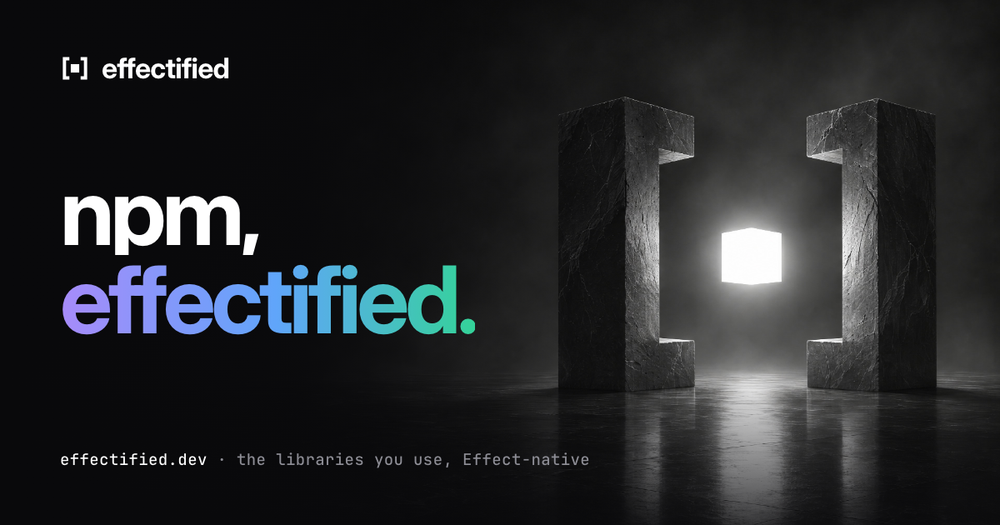

<p align="center">
  
</p>

# effectified.dev

The landing page of [effectified](https://github.com/effectified): Effect-native packages for the libraries you
already use, derived from upstream's own types so they keep up with every release.

Built on [Effect](https://effect.website). Not an official Effect project. A sibling of
[EffectScript](https://effectscript.dev), and it shares its design system.

## Develop

```sh
pnpm install --ignore-scripts
pnpm dev        # http://localhost:4321
pnpm check      # astro check
pnpm build      # static site in dist/
pnpm og         # re-render public/og.png from brand/og.html (needs Chrome)
```

## Deploy

```sh
CLOUDFLARE_ACCOUNT_ID=<account that holds the zone> pnpm run deploy
```

`cf deploy ./dist` serves `dist/` as an assets-only Worker, `effectified-site`, on the custom domain
`effectified.dev` (`cloudflare.config.ts`). Cloudflare created the DNS record and the certificate on the first deploy.
`cf` uses the login of `cf auth`; the account ID is needed when that login sees more than one account.

The `site` workflow deploys every push to `main` once the repository has two secrets:

- `CLOUDFLARE_API_TOKEN`: a token with the "Edit Cloudflare Workers" template, scoped to the account and the
  `effectified.dev` zone.
- `CLOUDFLARE_ACCOUNT_ID`: the account that holds the zone.

## Catalog

Every family and package the page lists is in [`src/data/catalog.ts`](src/data/catalog.ts). The counts on the page
are computed from it at build time; never write a number into the page by hand.

## Brand

The EffectScript exhibition system on ink: Effect's zinc palette, Inter Display for headlines, Inter for body,
JetBrains Mono for code and labels. The photographs stay monochrome; colour comes from code, as on
effect.website:

- Code uses `effectified-dark` (`src/code-theme.ts`): violet keywords, emerald strings, cyan for Effect's modules and
  types, blue functions, orange numbers, muted comments.
- The accent is the spectrum violet → sky → emerald (`--spectrum`), used sparingly: the hero's "effectified.", the
  ticker, the effectified code pane's edge and glow, and the light leak around the hero's cube.
- Each promise and each package kind has one colour from the code palette, shown as a dot or a thin rule.
- The signal colours (✓ pass, ! fail, ▲ warn, ◇ need) still mark state only, always with their glyph.

The mark is two brackets closed around a solid square: a library, wrapped. It lives in
[`public/mark.svg`](public/mark.svg) (`currentColor`) and [`public/favicon.svg`](public/favicon.svg). White on
black or black on white only. Never use the Effect logo, and describe the project as "built on Effect", never as
official or endorsed.

Fonts are subsets of Inter and JetBrains Mono under the SIL Open Font License ([`brand/`](brand)).

### Key visuals

Four monochrome scenes light the page's rooms: `hero` (the bracket monoliths around a cube of light), `contract`
(six wells of light), `pipeline` (raw stone, bracketed, lit) and `field` (every library, wrapped). Each room keeps
its copy on ink through a gradient scrim, never in a box. No people, no text and no logo inside an image.

- Masters: [`brand/key-visuals/*.jpg`](brand/key-visuals), 3840 px wide, generated with `gpt-image`
  (gpt-image-2.6-sunburst, quality max, complexity high) from the briefs in
  [`brand/key-visuals/prompts/`](brand/key-visuals/prompts): four drafts each, the best one rendered at 4K.
- Web sizes: `uv run --with pillow python scripts/images.py` writes `public/lp/<name>-<width>.webp`
  (828, 1440, 2560, 3840) from the masters; `src/components/Scene.astro` serves them as a `srcset`.
- `pnpm og` renders `public/og.png` from `brand/og.html` over the hero master.

## License

MIT
